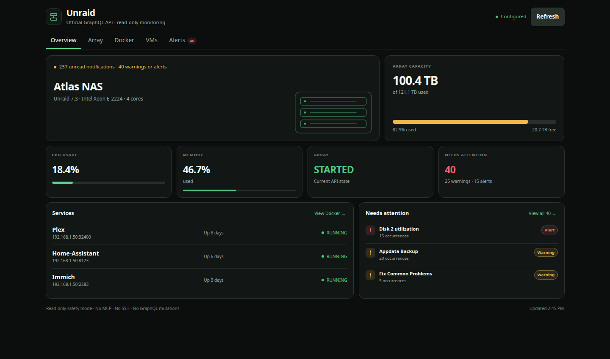
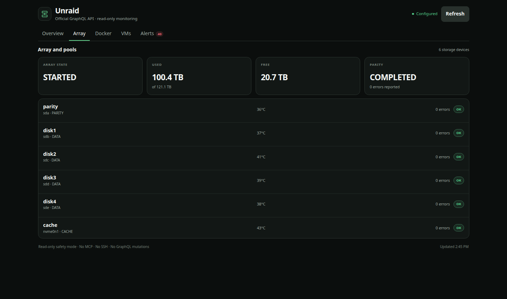
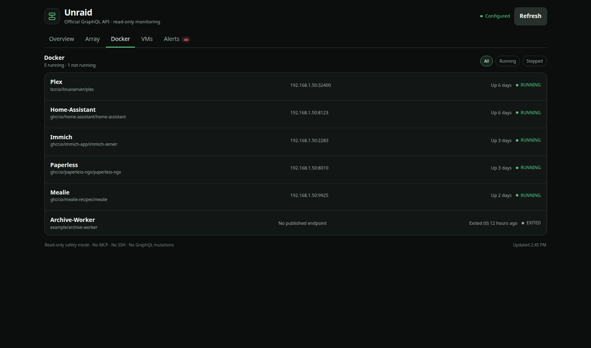
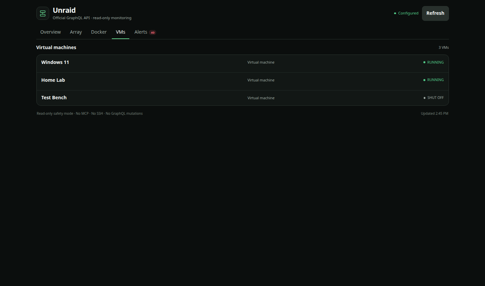
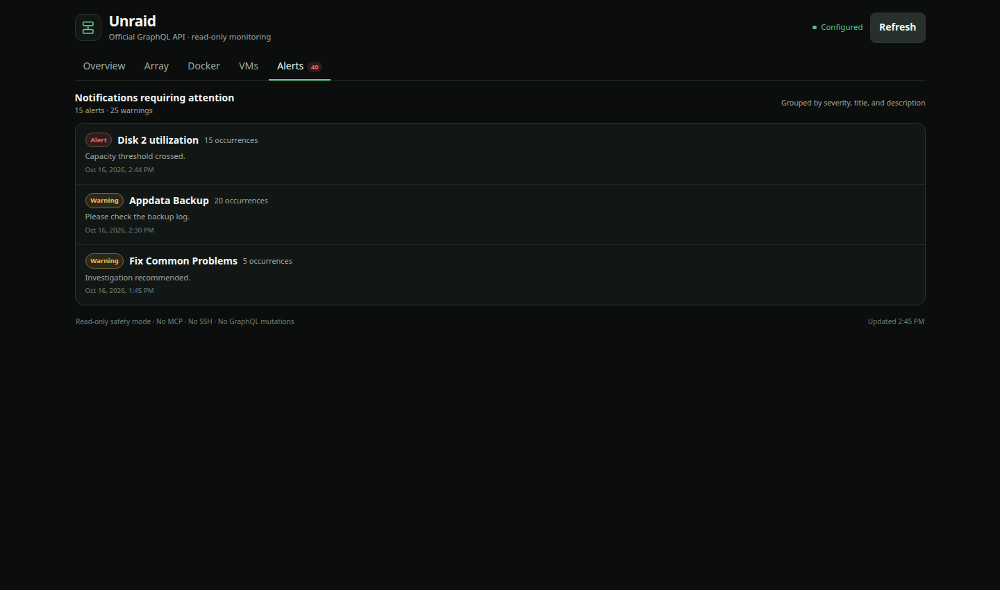

# Hermes Unraid

A read-only Unraid monitor for Hermes Desktop. It puts array capacity, Docker containers, virtual machines, and important notifications in one place without giving Hermes control of the server.

[Install in Hermes](hermes://plugin/install?repo=Anunnaki-Astronaut/hermes-unraid&enable=1)



## What it shows

- Server and Unraid version
- CPU and memory use
- Array capacity, parity-check state, storage temperatures, and reported errors
- Running and stopped Docker containers
- Running and shut-down virtual machines
- Grouped warning and alert notifications

The plugin is monitoring-only. It does not use SSH, MCP, shell commands, Unraid Connect, or GraphQL mutations.

## Screenshots

All screenshots use made-up data. They do not show a real server.

| Array and pools | Docker |
| --- | --- |
|  |  |

| Virtual machines | Alerts |
| --- | --- |
|  |  |

## Requirements

- Hermes Agent and Hermes Desktop 0.22.2 or newer
- An Unraid release with the official GraphQL API and **Settings → Management Access → API Keys** page
- Network access from the Hermes backend to the Unraid WebGUI
- A dedicated Unraid API key with the `VIEWER` role

The current release was manually tested with Unraid 7.3. Older releases may expose a different GraphQL schema.

## Install

### Option 1: install from Hermes Desktop

1. Click **Install in Hermes** above. If the link does not open, go to **Capabilities → Plugins → Install from Git**.
2. Enter:

   ```text
   Anunnaki-Astronaut/hermes-unraid
   ```

3. Review the source and select both the **Desktop** and **Agent/backend** parts.
4. Confirm the install, then enable **Unraid** in **Capabilities → Plugins**.

If Hermes Desktop connects to a backend on another machine, the two parts live on different machines:

- Install the **Desktop** part on the computer running Hermes Desktop.
- Install and enable the **Agent/backend** part on the computer running the Hermes backend.

Hermes shows the available targets in the install dialog. Installing only the Desktop part will show `Plugin not found` because the protected backend routes are missing.

### Option 2: install from the command line

Run this on the machine that hosts the Hermes backend:

```bash
hermes plugins install Anunnaki-Astronaut/hermes-unraid --enable
```

For a remote-backend setup, return to Hermes Desktop and use **Capabilities → Plugins → Install from Git** to install the Desktop part locally.

## Set up Unraid

### 1. Create a read-only API key

In the Unraid WebGUI:

1. Open **Settings → Management Access → API Keys**.
2. Choose **Create API Key**.
3. Give it a clear name such as `Hermes Unraid`.
4. Select the `VIEWER` role.
5. Copy the key when Unraid displays it.

Use a separate key for this plugin. Do not reuse an administrative key or an Unraid Connect key. Do not paste the key into chat, a URL, `plugin.js`, or a Git repository.

### 2. Find the GraphQL URL

Take the address you normally use for the Unraid WebGUI and add `/graphql`.

Examples:

```text
https://tower.example.net/graphql
http://192.168.1.50/graphql
http://192.168.1.50:88/graphql
```

Keep the port if the WebGUI uses a custom one. For example, a WebGUI at `http://192.168.1.50:88/` uses `http://192.168.1.50:88/graphql`.

### 3. Configure the plugin

1. In Hermes Desktop, open **Settings → Plugins → Unraid**.
2. Enter the full GraphQL URL.
3. Paste the `VIEWER` API key into the masked API-key field.
4. Leave **Allow plain HTTP on a trusted LAN** off when using HTTPS.
5. If Unraid is available only over plain HTTP, enable that switch only when both systems communicate over a private network you trust.
6. Save the settings and open **Unraid** from the Hermes sidebar.

HTTPS certificate verification is always enabled and cannot be bypassed. Fix the certificate or hostname if HTTPS verification fails.

## Troubleshooting

### `Not configured`

The selected Hermes backend profile is missing the GraphQL URL or API key. Open **Settings → Plugins → Unraid** while that backend/profile is selected and save both values.

### `Plugin not found`

The Desktop part is installed, but the backend part is not installed or enabled on the Hermes host that Desktop is connected to. Install the repository on that host and enable `unraid`.

### Unraid returns `403`

Check that the key came from **Management Access → API Keys**, has the `VIEWER` role, and belongs to the Unraid server in the configured URL.

### Plain HTTP is refused

Plain HTTP is blocked by default. Use HTTPS when possible. Otherwise, confirm that the address is private and trusted, then enable **Allow plain HTTP on a trusted LAN** in the plugin settings.

### The page still shows an older design

Open **Capabilities → Plugins** and choose **Rescan**, or restart Hermes Desktop. Unified plugins keep a local Desktop copy and refresh it during a rescan, install/update, or restart.

### Some fields are missing

Unraid API fields can vary by release. The plugin leaves unavailable values blank rather than guessing. Open a GitHub issue with the Unraid version and the visible error message, but remove addresses, hostnames, notification text, and keys first.

## Updating and removing

Update the backend package with:

```bash
hermes plugins update unraid
```

Then use **Capabilities → Plugins → Rescan** in Hermes Desktop so its local copy is refreshed.

Remove the backend package with:

```bash
hermes plugins remove unraid
```

You can also disable or remove the Desktop part from **Capabilities → Plugins**.

## Security and privacy

- The API key is stored in Hermes' protected profile credential store and is never sent to Desktop JavaScript.
- The backend sends the key only to the configured Unraid origin in the `x-api-key` header.
- The URL parser rejects embedded credentials, query strings, fragments, non-HTTP schemes, and endpoints that do not end in `/graphql`.
- Desktop callers can use only fixed read-only queries; they cannot send arbitrary GraphQL.
- Upstream error bodies are not passed through to the Desktop page.
- The plugin has no telemetry.

The plugin does display server metadata and notification text returned by Unraid. Treat screenshots and copied error reports as private until you have reviewed them.

See [SECURITY.md](SECURITY.md) for vulnerability reporting.

## Development

Tests use mocked Unraid responses and do not need a server or API key.

```bash
python -m pip install -r requirements-dev.txt
python -m pytest -q
node --check desktop/plugin.js
```

The checked-in screenshots are rendered from the real Desktop component with deterministic sample data:

```bash
node --experimental-vm-modules scripts/render_screenshot.cjs overview .screenshots-preview/overview.html
```

## Project status

Version 0.2.0 is the first public release. Monitoring is intentionally read-only. Any future repair or control feature should be a separate, clearly approved capability rather than an extension of the current API key permissions.

## License

MIT. See [LICENSE](LICENSE).

Unraid is a trademark of Lime Technology, Inc. This project is an independent community integration and is not affiliated with or endorsed by Lime Technology.
